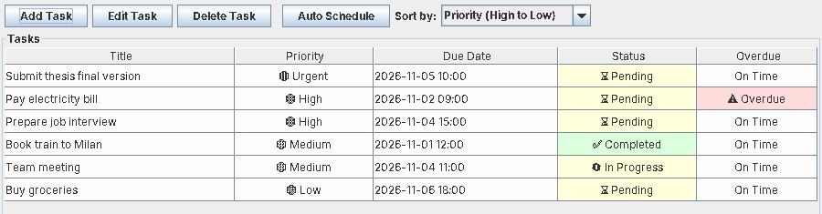

# Task Manager (Java, OOP Design Patterns)

**A desktop task manager in pure Java (Swing), built to show clean object-oriented design: MVC, Command, Observer, Strategy, Singleton and a producer/consumer queue with worker threads.**

By **Sepehr Mojdehdehbaher**. No external libraries, only the JDK.



## Features

- Create, edit and delete tasks with title, description, due date, priority (Urgent, High, Medium, Low) and status
- Sort by **priority** or by **deadline** (switchable at runtime)
- **Conflict detection**: two open tasks due in the same hour clash
- **Auto schedule**: moves a clashing task to the next free hour
- Overdue tasks highlighted, colour-coded priority and status
- Commands run through a **priority queue with 3 worker threads**; live queue statistics in the window

## Design

```
            ┌──────────── View (Swing) ─────────────┐
            │ TaskManagerView, TaskDialog, renderers │◄── Observer: refreshes on every change
            └───────────────┬───────────────────────┘
                            │ user actions
                     TaskController
                            │ creates Commands
                            ▼
      TaskQueue (Singleton) ── PriorityBlockingQueue ──► 3 × TaskWorker threads
                                                              │ execute()
                                                              ▼
                                             TaskManager (Singleton, thread-safe model)
                                                              │ uses
                                                              ▼
                                       ScheduleStrategy / PriorityStrategy (Strategy)
```

| Pattern | Where | Why |
|---|---|---|
| **MVC** | `model/`, `view/`, `controller/` | The GUI holds no business logic |
| **Command** | `command/` (Create, Update, Delete, Schedule, Batch) | Every action is an object that can be queued and prioritised |
| **Observer** | `observer/`, `TaskManager` → `TaskManagerView` | The table updates itself when data changes |
| **Strategy** | `strategy/` | Sorting (priority / deadline) and conflict resolution (next free hour / by priority) are swappable |
| **Singleton** | `TaskManager`, `TaskQueue` | One shared model and queue, double-checked locking |
| **Producer/consumer** | `queue/` | `PriorityBlockingQueue` + fixed thread pool, like a small message queue |

Thread safety: `ConcurrentHashMap` for tasks, `CopyOnWriteArrayList` for observers, GUI updates on the Swing event thread (`SwingUtilities.invokeLater`).

## Run it

Requires **Java 17+** (tested with Java 21).

```bash
git clone https://github.com/Sepi-X/task-manager-java.git
cd task-manager-java
javac -d out $(find src -name "*.java")
java -cp out Main
```

Or open the folder in IntelliJ IDEA and run `Main`.

## Tests

A small headless test (no GUI, no libraries) checks sorting, conflict rescheduling, the worker queue and shutdown:

```bash
javac -d out $(find src test -name "*.java")
java -cp out SmokeTest
```

```
8/8 tests passed
```

## Fixes in this version

Reviewing the original code before publishing found these bugs, now fixed:

1. **Did not compile**: `Priority` declared its own `compareTo`, which an enum cannot override. Renamed to `compareByWeight`.
2. **App crashed on start**: the view sorted the read-only list returned by `getAllTasks()`. It now sorts a copy.
3. **Wrong sort order**: enums compare by declaration order, so "High to Low" actually put Low first. Sorting now uses the priority weight.
4. **Auto schedule failed for existing tasks**: the strategies created a *new* task (new id), so updating it threw "Task not found". They now move the original task.
5. **Slow exit**: worker threads never stopped, so closing the app could hang for 60 seconds. Workers are now stopped first (exit in about 1 second).
6. Sort menu showed `HighPriorityFirstStrategy@2fe5122b` instead of a readable name; removed two empty unused classes.

## Project structure

```
src/
├── Main.java
├── command/      Command, Create/Update/Delete/Schedule/BatchCommand
├── controller/   TaskController
├── model/        Task, TaskManager, Priority, TaskStatus
├── observer/     TaskObserver, TaskSubject, TaskEvent, TaskEventType
├── queue/        TaskQueue, TaskWorker, CommandProcessor
├── strategy/     sorting and conflict-resolution strategies
└── view/         Swing window, dialog, table model, cell renderers
test/
└── SmokeTest.java
```

## Next steps

Save tasks to a file or database (currently kept in memory), undo/redo using the command history, and unit tests with JUnit.

## Tech

Java · Swing · java.util.concurrent · OOP design patterns
